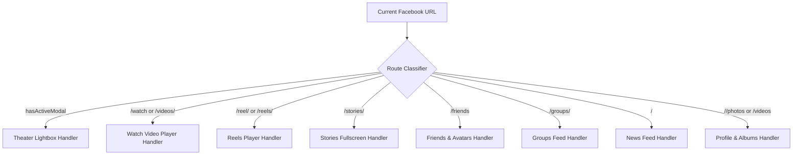

# 📘 Toystaller: Facebook Edition — Technical Specification & Deep Architecture Guide

> **Main Global Multi-Platform Repository:** [https://github.com/SudiptaSanki/Toystaller](https://github.com/SudiptaSanki/Toystaller)  
> **Facebook Specialized Repository:** [https://github.com/SudiptaSanki/Toystaller-Facebook](https://github.com/SudiptaSanki/Toystaller-Facebook)  
> **Version:** 1.0 (Specialized Edition)  
> **Specification Target:** Chromium Manifest V3

---

## 📑 Table of Contents
1. [Executive Summary & Motivation](#1-executive-summary--motivation)
2. [Why Standard Media Downloaders Fail on Facebook](#2-why-standard-media-downloaders-fail-on-facebook)
3. [System Architecture Overview](#3-system-architecture-overview)
4. [Component Deep Dive](#4-component-deep-dive)
   - [4.1 Main World Execution & Page Interceptor](#41-main-world-execution--page-interceptor)
   - [4.2 React Fiber & Relay State Inspection Engine](#42-react-fiber--relay-state-inspection-engine)
   - [4.3 Dynamic Network & Script Interception Pipeline](#43-dynamic-network--script-interception-pipeline)
   - [4.4 Content Script & Cross-World Messaging](#44-content-script--cross-world-messaging)
   - [4.5 Overlay Manager & Collision Resolution Engine](#45-overlay-manager--collision-resolution-engine)
   - [4.6 Theater Mode Isolation & Zero-Bleed Backdrop Engine](#46-theater-mode-isolation--zero-bleed-backdrop-engine)
   - [4.7 DeclarativeNetRequest & Referer Header Spoofing](#47-declarativeNetRequest--referer-header-spoofing)
   - [4.8 Background Service Worker & Download Pipeline](#48-background-service-worker--download-pipeline)
5. [Facebook Section-by-Section Handler Matrix](#5-facebook-section-by-section-handler-matrix)
6. [Performance, Memory & Lifecycle Optimization](#6-performance-memory--lifecycle-optimization)
7. [Security, Sandboxing & Privacy Guarantees](#7-security-sandboxing--privacy-guarantees)
8. [Comparison with Alternative Approaches](#8-comparison-with-alternative-approaches)
9. [Global Multi-Platform Ecosystem](#9-global-multi-platform-ecosystem)

---

## 1. Executive Summary & Motivation

**Toystaller: Facebook Edition** was engineered to solve a fundamental challenge in the modern web: **extracting original, full-resolution user photos and HD video streams from Facebook**. Meta's web application is one of the most sophisticated Single Page Applications (SPAs) in existence, powered by React, Relay, and GraphQL, utilizing dynamic adaptive streaming (DASH) and segmented blob streams (`blob:https://www.facebook.com/...`) to obscure direct media sources.

Traditional web scrapers and download tools fail because they:
1. Require users to copy and paste links into third-party websites rife with intrusive ads, trackers, and malicious popups.
2. Rely on scraping `<video>` tags from the DOM, which only exposes low-bitrate blob buffers or downscaled preview covers.
3. Cannot bypass Facebook's login walls or access media from private groups, friends, or protected albums.
4. Struggle with Facebook's fast-evolving GraphQL schemas.

**Toystaller operates entirely within the client's browser**, non-destructively reading memory states, React Fiber instances, Relay stream caches, and network buffers that the official Facebook web client has already authenticated and decrypted.

---

## 2. Why Standard Media Downloaders Fail on Facebook

Facebook implements multiple optimization and obfuscation layers:

```
[User Browser]
   ├── 1. Blob URLs: <video src="blob:https://www.facebook.com/xyz...">
   │      └── Direct download returns 0-byte or corrupted stream.
   ├── 2. DASH Segmentation: High-definition video and audio are split into tiny chunks.
   ├── 3. Custom DOM Overlay Layers: Transparent click-trap divs layer over <video>,
   │      intercepting all right-click and context menu events.
   ├── 4. Referer Verification on CDN: Requests to *.fbcdn.net or *.fbsbx.com lacking
   │      an official Referer header trigger HTTP 403 Forbidden.
   ├── 5. Inlined Relay Payloads: Initial video playback models are encoded inside
   │      <script type="application/json" data-sjs> tags rather than standard HTML attributes.
   └── 6. Single-Page Navigation (SPA): Theater mode (/photo/?fbid=...) renders
          as a modal dialog over the active feed without a full page reload.
```

Toystaller bypasses all six barriers directly at the browser runtime level without modifying Facebook's original DOM or triggering anti-bot heuristics.

---

## 3. System Architecture Overview

```
+-----------------------------------------------------------------------------------+
| CHROMIUM BROWSER RUNTIME                                                          |
|                                                                                   |
|  +-----------------------------------------------------------------------------+  |
|  | MAIN WORLD (Page Context - window)                                         |  |
|  |                                                                             |  |
|  |   [ Facebook React & Relay Application ]                                    |  |
|  |      │                                                                      |  |
|  |      ├─── React Fiber Tree (__reactFiber$, __reactProps$)                   |  |
|  |      │       ▲                                                              |  |
|  |      │       │ [Deep Object Traversal & Key Extraction]                     |  |
|  |      │   [ page_interceptor.js ]                                            |  |
|  |      │       ▲                                                              |  |
|  |      ├─── Network Hooks (window.fetch, window.XMLHttpRequest)               |  |
|  |      │       ▲                                                              |  |
|  |      └─── Embedded Relay Scripts (<script data-sjs>)                        |  |
|  |              │                                                              |  |
|  |              ▼ window.postMessage                                           |  |
|  +--------------┼--------------------------------------------------------------+  |
|                 │                                                                 |
|  +--------------┼--------------------------------------------------------------+  |
|  | ISOLATED CONTENT SCRIPT WORLD                                               |  |
|  |              ▼                                                              |  |
|  |   [ content_script.js ] ◄───► [ platforms/facebook.js ]                     |  |
|  |          │                                                                  |  |
|  |          ▼                                                                  |  |
|  |   [ overlay_manager.js ]                                                     |  |
|  |      ├── MutationObserver (Theater Dialog Detection)                        |  |
|  |      ├── IntersectionObserver (Media Viewport Tracking)                     |  |
|  |      ├── ResizeObserver (Dynamic Element Relocation)                        |  |
|  |      └── elementsFromPoint (Occlusion & Hover Hit Testing)                  |  |
|  |              │                                                              |  |
|  |              ▼ chrome.runtime.sendMessage                                   |  |
|  +--------------┼--------------------------------------------------------------+  |
|                 │                                                                 |
|  +--------------┼--------------------------------------------------------------+  |
|  | BACKGROUND SERVICE WORKER                                                   |  |
|  |              ▼                                                              |  |
|  |   [ background_script.js ]                                                  |  |
|  |      ├── chrome.downloads.download() ───► [ Local File System ]             |  |
|  |      ├── chrome.tabs.create()         ───► [ HD Media New Tab ]             |  |
|  |      └── declarativeNetRequest        ───► [ rules.json Referer Rewrite ]   |  |
|  +-----------------------------------------------------------------------------+  |
+-----------------------------------------------------------------------------------+
```

---

## 4. Component Deep Dive

### 4.1 Main World Execution & Page Interceptor
Chrome extension content scripts run by default in an **Isolated World**. While this protects DOM integrity, it hides the page's actual JavaScript runtime, React Fiber tree, and prototype chains (`window.fetch`, `window.XMLHttpRequest`).

Toystaller dynamically injects `platforms/facebook.js` and `page_interceptor.js` directly into the **MAIN world** using standard script tag injection at `document_start`:

```javascript
const script = document.createElement('script');
script.src = chrome.runtime.getURL('page_interceptor.js');
(document.head || document.documentElement).appendChild(script);
script.remove();
```

### 4.2 React Fiber & Relay State Inspection Engine
Facebook's React components store their full data models (including direct CDN URLs, progressive MP4 streams, and multi-resolution image arrays) inside internal DOM node properties prefixed with `__reactFiber$` or `__reactProps$`.

When a user hovers or clicks a media item:
1. The extension queries the target `<video>` or `` DOM node.
2. Traverses parent ancestors up to 14 levels in the DOM tree looking for Fiber instances.
3. Recursively scans the Fiber state tree for candidate fields:
   - `playable_url_quality_hd`: Facebook's master 1080p/720p progressive MP4 stream.
   - `browser_native_hd_url`: Alternative high-definition MP4 stream.
   - `playable_url`: Standard definition progressive MP4 stream fallback.
   - `progressive_download_url`: Unsegmented progressive video stream.
   - `video_versions`: Array of video streams sorted by height (`height: 1080`, `height: 720`).
   - `viewer_image` / `full_image` / `large_image` / `photo_image`: Uncompressed full-resolution photo URLs (`scontent.fbcdn.net`).
   - `display_resources` / `candidates`: Multi-resolution image candidate arrays.

### 4.3 Dynamic Network & Script Interception Pipeline
In addition to React Fiber inspection, `page_interceptor.js` monitors network traffic and embedded HTML data:
1. **Network Interceptor (`fetch` & `XMLHttpRequest`)**:
   - Watches for responses from `/api/graphql/`, `graphql`, `facebook.com`, and `*.fbcdn.net`.
   - Handles Facebook's `for (;;);` security prefix and newline-delimited JSONL streaming responses.
   - Parses payloads in real time, harvesting valid video and image CDN URLs into an indexed memory set.
2. **Embedded Relay Script Parser**:
   - Facebook embeds preloaded video and post data in `<script type="application/json" data-sjs>` tags.
   - `page_interceptor.js` parses these script tags on startup and when new scripts are dynamically injected, extracting HD video URLs instantly.
3. **Scoring Algorithm**:
   - Automatically ranks candidate URLs:
     $$\text{Score} = +25(\text{quality\_hd}) + 20(\text{video.fbcdn.net}) + 15(\text{.mp4}) + 20(\text{1080p}) - 50(\text{dash}) - 500(\text{thumbnail})$$

### 4.4 Content Script & Cross-World Messaging
Because the MAIN world interceptor and the Content Script live in different execution contexts, communication is handled via bi-directional asynchronous `window.postMessage` channels with unique random transaction IDs (`magic_get_react_url` ➔ `magic_response_react_url_${id}`) with a 350ms safety timeout fallback.

### 4.5 Overlay Manager & Collision Resolution Engine
Rather than altering Facebook's complex layout by appending child elements inside `<video>` wrappers or post cards, `OverlayManager` appends all UI elements directly to `document.body` with `position: fixed` and `z-index: 2147483646`.

Key features:
- **`ResizeObserver`**: Instantly tracks changes in media dimensions and viewport scaling.
- **`IntersectionObserver`**: Deactivates overlays for off-screen media (threshold: 15%).
- **Collision Avoidance**: Detects native Facebook interactive controls (Scrubber bar, Play/Pause, Volume, Fullscreen, Like/React, Comments) and shifts buttons to safe alternative corners.

### 4.6 Theater Mode Isolation & Zero-Bleed Backdrop Engine
On Facebook, clicking any photo or video opens full-screen Theater Mode (`div[data-pagelet="MediaViewer"]` or `[role="dialog"]`) over the existing feed.

**The Zero-Bleed Solution:**
1. A real-time `MutationObserver` monitors modal creation/removal.
2. When a modal opens (`hasActiveModal() === true`), all background overlays outside the modal are immediately forced to `display: none; visibility: hidden; pointer-events: none;`.
3. Pointer hit testing (`document.elementsFromPoint`) verifies that cursor coordinates directly intersect with the active modal media before allowing any overlay to display.

### 4.7 DeclarativeNetRequest & Referer Header Spoofing
When opening direct CDN links (`https://video.fbcdn.net/...` or `https://scontent.fbcdn.net/...`) in a new browser tab, Facebook returns HTTP 403 Forbidden because the request lacks an internal Facebook Referer header.

Toystaller includes a declarative net request ruleset in `rules.json`:
```json
[
  {
    "id": 1,
    "priority": 1,
    "action": {
      "type": "modifyHeaders",
      "requestHeaders": [
        { "header": "Referer", "operation": "set", "value": "https://www.facebook.com/" },
        { "header": "Origin", "operation": "set", "value": "https://www.facebook.com" }
      ]
    },
    "condition": {
      "urlFilter": "||fbcdn.net",
      "resourceTypes": ["main_frame", "sub_frame", "media", "xmlhttprequest"]
    }
  },
  {
    "id": 2,
    "priority": 1,
    "action": {
      "type": "modifyHeaders",
      "requestHeaders": [
        { "header": "Referer", "operation": "set", "value": "https://www.facebook.com/" },
        { "header": "Origin", "operation": "set", "value": "https://www.facebook.com" }
      ]
    },
    "condition": {
      "urlFilter": "||fbsbx.com",
      "resourceTypes": ["main_frame", "sub_frame", "media", "xmlhttprequest"]
    }
  }
]
```
This ensures uninhibited playback and clean direct file downloads in any browser tab.

### 4.9 Built-in HTML5 Video Player & Anti-Redirect Pipeline (`player.html` & `player.js`)
When navigating to an `fbcdn.net` video stream URL directly via top-level address bar navigation, Meta's edge servers reject the request (`Sec-Fetch-Dest: document`) and return an HTTP 302 redirect to `https://www.facebook.com/`. 

Toystaller circumvents this 100% on the client side without needing an external proxy or local yt-dlp backend:
1. Video URLs opened via the blue button are routed to `player.html?url=<encoded_video_url>`.
2. `player.html` instantiates an HTML5 `<video controls autoplay playsinline>` element.
3. Because the media request originates from an HTML `<video>` tag, Chromium issues `Sec-Fetch-Dest: video` with proper Referer headers injected by `rules.json`.
4. Meta's CDN serves the uncompressed master HD MP4 with complete multiplexed audio (AAC) at full bandwidth (`HTTP 200/206`).
5. A native **Download Video** button triggers `chrome.downloads.download` to save the MP4 directly to the user's Downloads folder with a clean, timestamped filename.

---

## 5. Facebook Section-by-Section Handler Matrix



| Section | Detection Rule | Target Strategy | Filter Strategy |
| :--- | :--- | :--- | :--- |
| **Theater Mode** | `[role="dialog"]`, `div[data-pagelet="MediaViewer"]` | Fullscreen photo or video | Rejects background feed items, comment avatars |
| **Facebook Watch** | `/watch`, `/videos/` | Primary player `<video>` | Rejects scrubber bar, recommended side video thumbnails |
| **Reels** | `/reel/`, `/reels/` | Viewport-centered active vertical reel | Top-right placement below search button; clears sound slider on left |
| **News Feed** | `/` (Home) | Main post `<article>` media, collages, carousel reels | Smooth auto-hide on scroll; hard barrier preventing navbar leakage |
| **Friends** | `/friends` | Friend request cards, suggestions, avatars | Parses SVG `<image>` and standard `` tags down to 32px |
| **Stories** | `/stories/` | Screen-centered active story | Rejects blurred left/right story preview cards |
| **Groups** | `/groups/` | Group post media attachments | Rejects member badges and avatars |
| **Profile & Albums** | `/<user>/photos`, `/<user>` | Album grids, cover photo, profile avatar | Rejects icons `< 60px` |

---

## 6. Performance, Memory & Lifecycle Optimization

- **Throttled Pointer Events**: Mousemove handlers are throttled to 30ms intervals to eliminate frame drops and maintain 60/120fps scrolling.
- **Garbage Collection Safety**: DOM nodes are tracked in `Map` collections; when media elements are detached from the DOM, their corresponding observers and overlay containers are disconnected and removed.
- **Context Invalidation Protection**: All background messaging calls are wrapped in `safeSendMessage` try-catch blocks to prevent console warnings when the extension is updated or reloaded during an active session.

---

## 7. Security, Sandboxing & Privacy Guarantees

1. **Zero External Communication**: The extension never makes network calls to external analytical, tracking, or proxy servers. All requests remain within `facebook.com` and `*.fbcdn.net`.
2. **Read-Only Inspection**: React Fiber states, Relay stores, and GraphQL responses are read in memory without modifying client-side session tokens, cookies, or account credentials.
3. **Shadow DOM Isolation**: The dashboard UI is rendered inside a closed-mode `ShadowRoot`, completely immune to host page CSS pollution.

---

## 8. Comparison with Alternative Approaches

| Feature / Metric | Toystaller: Facebook Edition | Generic Web Scraper / Web Tools | DOM Video Scraping Extensions |
| :--- | :--- | :--- | :--- |
| **Video Quality** | **1080p / 720p HD MP4 (`playable_url_quality_hd`)** | Often capped at 480p/720p | Capped at compressed preview |
| **Image Resolution** | **Uncompressed Original (up to 2048px+)** | Compressed JPEG | Screen-size cropped preview |
| **Account Safety** | **100% Safe (Local client-side)** | High risk (Requires login/cookies) | Safe |
| **Speed** | **Instant (0 ms network overhead)** | Slow (Server processing time) | Instant |
| **Advertisements / Trackers** | **None (Zero)** | Heavy Adware / Popups | Minimal |
| **Private Group / Friend Support** | **Yes (If your account has access)** | No | Limited |

---

## 9. Global Multi-Platform Ecosystem

Toystaller was engineered as a modular framework. While this repository represents the **specialized standalone edition for Facebook**, the **Main Global Repository** provides multi-platform capabilities across the entire social web:

- 📘 **Facebook**: Watch HD Extraction, Reels, Theater Mode, Photos, Feed, Groups.
- 📷 **Instagram**: Reels, Stories, High-Res Posts, Profile Avatars, DMs.
- 💼 **LinkedIn**: Uncompressed Document Images, Native Video Streams.
- 💬 **WhatsApp Web**: Full-Resolution Media Attachments & Voice Notes.

👉 **Explore the Main Project:** [https://github.com/SudiptaSanki/Toystaller](https://github.com/SudiptaSanki/Toystaller)

---

<div align="center">
<b>Toystaller Architecture Documentation</b> • Maintained by <a href="https://github.com/SudiptaSanki">Sudipta Sanki</a>
</div>
