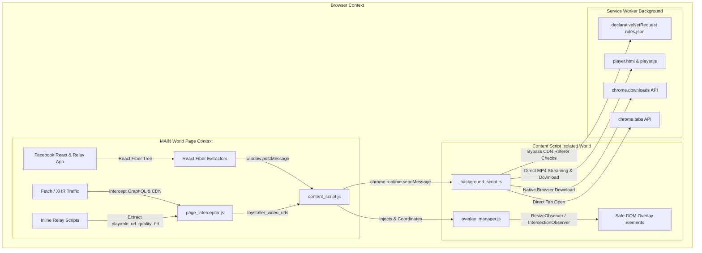

<div align="center">

# 🧸 Toystaller: Facebook Edition (v1.0)

**High-Performance, Stealth Media Downloader & Media Viewer for Facebook**

[](https://developer.chrome.com/docs/extensions/mv3/intro/)
[](https://facebook.com)
[](https://github.com/SudiptaSanki/Toystaller)
[](LICENSE)
[](DETAILS.md)

*A specialized, 100% client-side Chromium extension that extracts original master HD videos with complete audio and uncompressed photos from Facebook Watch, Reels, Stories, Theater Mode, News Feed, Friends, Groups, and Profiles without external servers or compression.*

---

### 🌐 Official Repositories & Documentation
* **Facebook Specialized Edition:** [https://github.com/SudiptaSanki/Toystaller-Facebook](https://github.com/SudiptaSanki/Toystaller-Facebook)
* **Instagram Specialized Edition:** [https://github.com/SudiptaSanki/Toystaller-Instagram](https://github.com/SudiptaSanki/Toystaller-Instagram)
* **Main Global Multi-Platform Suite:** [https://github.com/SudiptaSanki/Toystaller](https://github.com/SudiptaSanki/Toystaller) *(Facebook, Instagram, LinkedIn, WhatsApp)*
* **Deep Technical Specification & Architecture:** [`DETAILS.md`](DETAILS.md)

</div>

---

## 🚀 Overview

**Toystaller: Facebook Edition** is an advanced browser extension engineered specifically for Facebook's modern single-page React/Relay architecture. Traditional downloaders rely on server-side scrapers that require you to paste links into ad-filled websites, or they scrape low-resolution `blob:` preview URLs from the DOM.

Toystaller operates **100% client-side** inside your browser with **zero external backend server dependencies** (no local yt-dlp or ffmpeg server required). It directly accesses Facebook's internal React Fiber tree, Relay preloaded stream caches, and network buffers to extract the original, full-resolution progressive master MP4 videos (`playable_url_quality_hd`) and maximum-quality photos directly from Facebook's official CDN (`*.fbcdn.net`).

---

## ⚡ Features & Section Support

| Facebook Section | Supported Media | Extraction Capability | UI & Behavior |
| :--- | :--- | :--- | :--- |
| **Theater Mode / Lightbox (`[role="dialog"]`)** | Photos, High-Res Images & Fullscreen Videos | Original uncompressed JPEG/PNG, 1080p/720p master MP4 | **Zero-Bleed Isolation**: Instantly suppresses background feed overlays |
| **Facebook Watch (`/watch`, `/videos/`)** | Long-form Video Player & Streams | Native progressive HD MP4 (`playable_url_quality_hd`), video poster | Positioned safely in top/bottom-left avoiding player scrubber & controls |
| **Facebook Reels (`/reel/`, `/reels/`)** | Vertical Video Player (9:16 & 16:9) | Direct master MP4 stream with AAC audio + Video poster | **Conflict-Free Placement**: Positioned in the top-right corner below the native search icon, completely clear of the volume slider |
| **News Feed (`/`)** | Posts, Photo Collages, Carousel Reels, Inline Videos | Highest resolution candidate or unscaled React Fiber master photo | **Carousel Support & Zero-Leak**: Seamlessly hover any reel in horizontal trays; auto-hides on scroll to prevent navbar leakage |
| **Friends (`/friends`)** | Profile Avatars, Friend Requests & Suggestions | Original high-resolution avatar photos (with full SVG `<image>` support) | Hover over any friend card or list item for instant download buttons |
| **Stories (`/stories/`)** | Video Stories & Photos | Active story media stream without overlays | Positioned safely below top story progress indicators |
| **Groups (`/groups/`)** | Group Feed Posts, Photos & Videos | Original quality media attachments | Unobtrusive button overlays on post media |
| **Profiles & Albums (`/<user>/photos`, `/<user>/videos`)** | Timeline Posts, Photo Albums, Cover & Avatar | Full album tile downloads, high-res profile picture, full cover photo | Clear hover buttons inside grid tiles |

---

## 🛠️ Technology Stack & Architecture

Toystaller is built with **Pure Modern Vanilla JavaScript** (ES2022+), zero third-party dependencies, and adheres strictly to **Google Chrome Manifest V3 specifications**.



### Core Technologies:
1. **Built-in HTML5 Video Player (`player.html` & `player.js`)**:
   - Meta's CDN blocks raw address bar navigation to video files with an HTTP 302 redirect to `facebook.com`.
   - Toystaller solves this 100% client-side by routing video links to an internal, ad-free dark-mode player page that streams the video directly with full audio using the native `<video>` engine, and provides a 1-click **Download Video** button and **Copy Link** button.
2. **Manifest V3 Service Worker (`background_script.js`)**:
   - Manages asynchronous download pipelines via `chrome.downloads`.
   - Intercepts raw network response headers with `chrome.webRequest` for fallback URL tracking.
3. **Declarative Net Request Header Rewriting (`rules.json`)**:
   - Facebook CDN (`*.fbcdn.net`, `*.fbsbx.com`) validates referrers. Toystaller uses `declarativeNetRequest` rules to maintain proper `facebook.com` headers.
4. **Main-World React Fiber & Relay Hooking (`page_interceptor.js`)**:
   - Accesses DOM elements' internal `__reactFiber$`, `__reactProps$`, and Relay caches.
   - Extracts complete `playable_url_quality_hd` (1080p/720p HD MP4), `browser_native_hd_url`, and `full_image.uri` directly from React component state.
5. **Network & Script Interceptor (`page_interceptor.js`)**:
   - Overrides `window.fetch` and `window.XMLHttpRequest` in the page context.
   - Captures Facebook GraphQL (`/api/graphql/`) batch streams and parses embedded `<script type="application/json">` Relay chunks.
6. **Geometry & Occlusion Engine (`overlay_manager.js`)**:
   - Uses `IntersectionObserver`, `ResizeObserver`, and hit testing.
   - Dynamically calculates best corner placement avoiding native Facebook controls (Like, Comment, Share, Play/Pause).
   - Auto-hides on scroll and enforces a hard boundary at Facebook's top header banner to prevent overlays from leaking into the navbar.
7. **Per-Section Toggle Settings (`popup.html` & `popup.js`)**:
   - Popup control panel allowing users to toggle overlays individually for Feed & Groups, Watch Videos, Reels, Stories, and Photos/Albums.

*(For exhaustive architectural diagrams and algorithms, read [`DETAILS.md`](DETAILS.md)).*

---

## 📦 Detailed Installation Guide (Step-by-Step)

To install and run **Toystaller: Facebook Edition** on any Chromium-based browser (Google Chrome, Brave, Microsoft Edge, Opera, Vivaldi, Arc):

### Prerequisites
- Any modern Chromium browser (Chrome 102+ recommended).
- Git installed on your machine (or download the source ZIP).

---

### Step 1: Clone or Download the Repository
Run the following command in your terminal:
```bash
git clone https://github.com/SudiptaSanki/Toystaller-Facebook.git
```
*Or download and extract the repository ZIP from GitHub to your preferred directory.*

---

### Step 2: Open Browser Extensions Page
1. Open your Chromium browser.
2. In the URL address bar, enter the corresponding URL:
   - **Google Chrome**: `chrome://extensions/`
   - **Brave Browser**: `brave://extensions/`
   - **Microsoft Edge**: `edge://extensions/`
   - **Opera**: `opera://extensions/`

---

### Step 3: Enable Developer Mode
Look in the top-right corner of the Extensions page and toggle the switch labeled **Developer mode** to **ON**.

```text
[ Developer mode ]  <--- (Toggle this to ON)
```

---

### Step 4: Load Unpacked Extension
1. Click on the **Load unpacked** button in the top-left toolbar.
2. In the folder selection dialog, select the root project directory:
   ```text
   Toystaller-Facebook/
   ```
   *(Or select the self-contained `facebook/` subdirectory; both contain valid `manifest.json` configurations).*
3. Click **Select Folder** (or **Open**).

---

### Step 5: Pin and Verify the Extension
1. Click the **Puzzle icon** (Extensions menu) in your browser toolbar.
2. Locate **Toystaller: Facebook Edition** and click the **Pin icon** to pin it to your toolbar.
3. Open [Facebook](https://www.facebook.com/) or refresh any existing Facebook tab.
4. Hover over any post, video, reel, story, friend card, or photo — you will see the **Blue (Open Media)** and **Red (Open Poster)** overlay buttons!

---

## 🎯 How to Use

1. **Download / Play Video in Full HD**:
   - Hover over any Watch video, Reel, or Feed video.
   - Click the **Blue Button** with the arrow icon. The video opens instantly in the built-in Toystaller player tab with full master audio (AAC) and HD video.
   - Click **Download Video** in the player header to save the `.mp4` file directly, or click **Copy Link**.
2. **Download / Open High-Res Photo**:
   - Hover over any post image, photo album tile, friend profile picture, or header avatar.
   - Click the **Blue Button** to open the uncropped master photo directly.
3. **Open Poster / Video Thumbnail**:
   - Hover over any video or reel.
   - Click the **Red Button** to extract the full-size video cover artwork.
4. **Customize Overlay Visibility**:
   - Click the Toystaller icon in your browser toolbar to toggle overlays on/off for specific sections (Feed, Watch, Reels, Stories, Photos).

---

## 📂 Project Structure

```text
Toystaller-Facebook/
├── manifest.json            # Extension manifest (MV3, permissions, content scripts)
├── background_script.js     # Background Service Worker for downloads & webRequest
├── content_script.js        # Content script orchestrator & button injection
├── overlay_manager.js       # Smart DOM positioning, collision & modal isolation
├── page_interceptor.js      # Main-world Fetch/XHR interceptor & React Fiber reader
├── player.html              # Dedicated ad-free HTML5 video player page
├── player.js                # Player controller (playback, direct download, copy link)
├── rules.json               # DeclarativeNetRequest header rules for *.fbcdn.net
├── popup.html               # Popup settings panel UI
├── popup.js                 # Popup settings logic & tab synchronization
├── Toystaller_logo.png      # Extension branding & icons
├── platforms/
│   └── facebook.js          # Dedicated Facebook section detector & quality extractors
├── core/                    # Shared modular core architecture
│   ├── background_core.js
│   ├── content_core.js
│   ├── interceptor_core.js
│   └── overlay_manager.js
├── facebook/                # Self-contained standalone Facebook Edition package
│   ├── manifest.json
│   ├── background.js
│   ├── content.js
│   ├── platform.js
│   ├── player.html
│   ├── player.js
│   ├── rules.json
│   ├── icon.png
│   └── core/
├── DETAILS.md               # Exhaustive technical documentation & architecture guide
├── CONTRIBUTING.md          # Technical contributor guide
├── LICENSE                  # MIT License
└── README.md                # Project documentation & installation manual
```

---

## 🛡️ Privacy & Security

- **100% Client-Side**: No user data, cookies, authentication tokens, or media URLs are ever transmitted to external servers.
- **Zero Third-Party Trackers**: No analytics, telemetry, or external dependencies.
- **No Risk of Account Bans**: Operates purely through standard browser-authenticated requests without automated scrapers or suspicious API calls.
- **Direct CDN Streams**: Media files are fetched directly from Facebook's official CDN servers (`*.fbcdn.net`).

---

## 🤝 Contributing & Support

Contributions, feature suggestions, and bug reports are warmly welcome!
- Check out the **Main Global Repository** for multi-platform support (Instagram, Facebook, LinkedIn, WhatsApp): [https://github.com/SudiptaSanki/Toystaller](https://github.com/SudiptaSanki/Toystaller)
- Read the **Technical Architecture Guide**: [`DETAILS.md`](DETAILS.md)
- Open an Issue or Pull Request on [GitHub Issues](https://github.com/SudiptaSanki/Toystaller-Facebook/issues).

---

<div align="center">
  <sub>Built with ❤️ for privacy and uncompressed media freedom.</sub>
</div>
