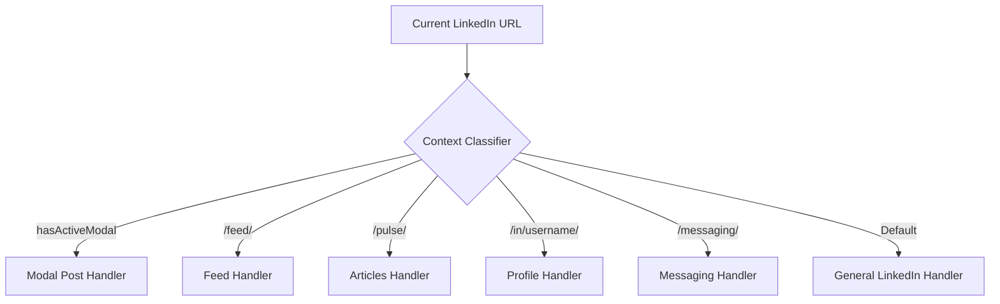

# 📘 Toystaller: LinkedIn Edition — Technical Specification & Deep Architecture Guide

> **Main Global Multi-Platform Repository:** [https://github.com/SudiptaSanki/Toystaller](https://github.com/SudiptaSanki/Toystaller)  
> **LinkedIn Specialized Repository:** [https://github.com/SudiptaSanki/Toystaller-LinkedIn](https://github.com/SudiptaSanki/Toystaller-LinkedIn)  
> **Version:** 1.0 (Specialized Edition)  
> **Specification Target:** Chromium Manifest V3

---

## 📑 Table of Contents
1. [Executive Summary & Motivation](#1-executive-summary--motivation)
2. [Why Standard Media Downloaders Fail on LinkedIn](#2-why-standard-media-downloaders-fail-on-linkedin)
3. [System Architecture Overview](#3-system-architecture-overview)
4. [Component Deep Dive](#4-component-deep-dive)
   - [4.1 Main World Execution & Page Interceptor](#41-main-world-execution--page-interceptor)
   - [4.2 DOM & React Fiber State Inspection Engine](#42-dom--react-fiber-state-inspection-engine)
   - [4.3 Dynamic Network Interception Pipeline](#43-dynamic-network-interception-pipeline)
   - [4.4 Anti-Redirect In-Browser HTML5 Player (The 302 Bypass Trick)](#44-anti-redirect-in-browser-html5-player-the-302-bypass-trick)
   - [4.5 DeclarativeNetRequest & Header Injection](#45-declarativenetrequest--header-injection)
   - [4.6 Overlay Manager & Corner-Locking Stability Engine](#46-overlay-manager--corner-locking-stability-engine)
   - [4.7 Modal Isolation & Zero-Bleed Backdrop Engine](#47-modal-isolation--zero-bleed-backdrop-engine)
   - [4.8 LinkedIn CDN URL Upgrading](#48-linkedin-cdn-url-upgrading)
   - [4.9 Background Service Worker & Download Pipeline](#49-background-service-worker--download-pipeline)
5. [LinkedIn Section-by-Section Handler Matrix](#5-linkedin-section-by-section-handler-matrix)
6. [Performance, Memory & Lifecycle Optimization](#6-performance-memory--lifecycle-optimization)
7. [Security, Sandboxing & Privacy Guarantees](#7-security-sandboxing--privacy-guarantees)
8. [Comparison with Alternative Approaches](#8-comparison-with-alternative-approaches)
9. [Global Multi-Platform Ecosystem](#9-global-multi-platform-ecosystem)

---

## 1. Executive Summary & Motivation

**Toystaller: LinkedIn Edition** was created to solve a fundamental problem in the modern web: **access to original, uncompressed user media**. Social media networks such as LinkedIn employ sophisticated client-side rendering engines, dynamic adaptive streaming (DASH/HLS), and blob-based video players to obscure direct media sources.

Traditional approaches either:
1. Require users to copy URLs and paste them into third-party websites loaded with advertisements, trackers, and aggressive rate limits.
2. Rely on scraping public video tags from the DOM, which only exposes low-bitrate blob URLs or heavily compressed video segments.
3. Query external server-side APIs that frequently break whenever LinkedIn updates its internal Voyager API schemas.

**Toystaller operates entirely within the client's browser**, non-destructively reading memory states and network buffers that the official LinkedIn web client has already authenticated and decrypted.

---

## 2. Why Standard Media Downloaders Fail on LinkedIn

LinkedIn's web client implements multiple anti-scraping and optimization layers:

```
[User Browser]
   ├── 1. Blob URLs: <video src="blob:https://linkedin.com/xyz...">
   │      └── Direct download returns 0-byte or corrupted stream.
   ├── 2. DASH Segmentation: Video streams are split via DASH manifests (.mpd).
   ├── 3. Custom DOM Overlay Layers: Transparent divs layer over <video>,
   │      intercepting all right-click and context menu events.
   ├── 4. CDN 403 / 302 Restrictions: Direct navigation to CDN video URLs in a browser tab
   │      triggers HTTP 302 redirects back to the login page or HTTP 403 Forbidden.
   └── 5. Single-Page Navigation (SPA): Posts opened from feed render
          as modals without a full page reload, leaving background media active.
```

Toystaller bypasses all five barriers directly at the browser runtime level without modifying LinkedIn's original DOM or triggering anti-bot heuristics.

---

## 3. System Architecture Overview

```
+-----------------------------------------------------------------------------------+
| CHROMIUM BROWSER RUNTIME                                                          |
|                                                                                   |
|  +-----------------------------------------------------------------------------+  |
|  | MAIN WORLD (Page Context - window)                                         |  |
|  |                                                                             |  |
|  |   [ LinkedIn Web Application ]                                             |  |
|  |      │                                                                      |  |
|  |      ├─── DOM data-sources Attribute (video progressive URLs)              |  |
|  |      ├─── React Fiber Tree (__reactFiber$, __reactProps$)                   |  |
|  |      │       ▲                                                              |  |
|  |      │       │ [Deep Object Traversal Engine]                               |  |
|  |      │   [ page_interceptor.js + platforms/linkedin.js ]                    |  |
|  |      │       ▲                                                              |  |
|  |      └─── Network Hooks (window.fetch, window.XMLHttpRequest)               |  |
|  |              │                                                              |  |
|  |              ▼ window.postMessage                                           |  |
|  +--------------┼--------------------------------------------------------------+  |
|                 │                                                                 |
|  +--------------┼--------------------------------------------------------------+  |
|  | ISOLATED CONTENT SCRIPT WORLD                                               |  |
|  |              ▼                                                              |  |
|  |   [ content_script.js ] ◄───► [ platforms/linkedin.js ]                     |  |
|  |          │                                                                  |  |
|  |          ▼                                                                  |  |
|  |   [ overlay_manager.js ]                                                     |  |
|  |      ├── MutationObserver (Modal Dialog Detection)                          |  |
|  |      ├── IntersectionObserver (Media Viewport Tracking)                     |  |
|  |      ├── ResizeObserver (Dynamic Element Relocation)                        |  |
|  |      └── elementsFromPoint (Occlusion & Hover Hit Testing)                  |  |
|  |              │                                                              |  |
|  |              ▼ chrome.runtime.sendMessage                                   |  |
|  +--------------┼--------------------------------------------------------------+  |
|                 │                                                                 |
|  +--------------┼--------------------------------------------------------------+  |
|  | BACKGROUND SERVICE WORKER                                                   |  |
|  |              ▼                                                              |  |
|  |   [ background_script.js ]                                                  |  |
|  |      ├── chrome.downloads.download() ───► [ Local File System ]             |  |
|  |      ├── player.html & player.js     ───► [ Anti-Redirect In-Browser Player ] |
|  |      ├── chrome.tabs.create()         ───► [ High-Res Image Tab ]           |  |
|  |      └── declarativeNetRequest        ───► [ rules.json Referer Rewrite ]   |  |
|  +-----------------------------------------------------------------------------+  |
+-----------------------------------------------------------------------------------+
```

---

## 4. Component Deep Dive

### 4.1 Main World Execution & Page Interceptor
Chrome extension content scripts run by default in an **Isolated World**. While this protects DOM integrity, it hides the page's actual JavaScript runtime, React Fiber tree, and prototype chains (`window.fetch`, `window.XMLHttpRequest`).

Toystaller dynamically injects `platforms/linkedin.js` and `page_interceptor.js` directly into the **MAIN world** using script tag injection at `document_start`:

```javascript
const script = document.createElement('script');
script.src = chrome.runtime.getURL('page_interceptor.js');
(document.head || document.documentElement).appendChild(script);
script.remove();
```

### 4.2 DOM & React Fiber State Inspection Engine
LinkedIn encodes media sources in two distinct locations:
1. **DOM `<video data-sources="...">`**: LinkedIn embeds JSON-encoded video playback streams directly onto `<video>` tags with bitrate metadata (`data-bitrate`). Toystaller parses this attribute and automatically selects the highest-bitrate progressive MP4.
2. **React Fiber Instances (`__reactFiber$`, `__reactProps$`)**: Toystaller traverses component trees up to 12 levels to extract `streamingUrl` and `progressiveUrl` directly from React component state, while strictly excluding poster/cover images.

### 4.3 Dynamic Network Interception Pipeline
`page_interceptor.js` patches `window.fetch` and `window.XMLHttpRequest` in the page context to monitor background Voyager API calls (`/voyager/api/`). Captured media URLs are sanitized and posted to the content script.

### 4.4 Anti-Redirect In-Browser HTML5 Player (The 302 Bypass Trick)
When a user opens a raw CDN link in a tab, the browser issues a top-level document navigation (`Sec-Fetch-Dest: document`), which CDNs reject with an HTTP 302 redirect. Toystaller routes video URLs to an internal player page:
```javascript
const playerUrl = chrome.runtime.getURL('player.html') + '?url=' + encodeURIComponent(videoUrl);
chrome.tabs.create({ url: playerUrl });
```
Inside `player.html`, the media request originates from an HTML `<video>` element (`Sec-Fetch-Dest: video; Sec-Fetch-Mode: no-cors`), which CDNs accept and serve with full audio and video.

### 4.5 DeclarativeNetRequest & Header Injection
In `rules.json`, rules rewrite outgoing requests to `licdn.com` and `linkedin.com` to include official `Referer: https://www.linkedin.com/` and `Origin: https://www.linkedin.com` headers, defeating CDN referrer validation.

### 4.6 Overlay Manager & Corner-Locking Stability Engine
- **Corner-Locking Engine**: Once an optimal corner (`top-left` or `top-right`) is selected for a media element, it is **permanently locked**. The button never dynamically jumps down to `bottom-right` or alternates corners while scrolling.
- **Sticky Header Handling**: As media scrolls under LinkedIn's fixed navbar (`#global-nav`), the overlay gracefully hides (`top < topNavHeight + 4`). It never clamps or slides along the navbar.
- **Per-Section Toggles**: Supported via `popup.html` and `popup.js`, allowing users to toggle overlays individually for Feed Posts, Articles, Profiles, and Messaging.

### 4.7 Modal Isolation & Zero-Bleed Backdrop Engine
LinkedIn opens posts and articles in modal dialogs (`.artdeco-modal`, `[role="dialog"]`). A `MutationObserver` instantly detects when a dialog opens, hiding overlays on background feed media so buttons only appear on the active modal.

### 4.8 LinkedIn CDN URL Upgrading
Image URLs from `media.licdn.com/dms/image` contain resolution tokens (`/100/`, `/200/`, `/400/`, `/800/`). Toystaller automatically upgrades these to `/1000/` for maximum clarity.

### 4.9 Background Service Worker & Download Pipeline
`background_script.js` handles file saving through `chrome.downloads.download({ url, filename, saveAs: true })` and routes media tabs cleanly.

---

## 5. LinkedIn Section-by-Section Handler Matrix



| Section | Detection Rule | Target Strategy | Filter Strategy |
| :--- | :--- | :--- | :--- |
| **Modal Dialog** | `.artdeco-modal, [role="dialog"]` (size > 400×400) | Modal-contained media only | Rejects all background feed items |
| **Feed** | `/feed/` | Post images (`naturalW ≥ 200`), native videos | Rejects circular profile pictures (`border-radius: 50%`), icons `< 100px` |
| **Articles** | `/pulse/`, `/article/` | Embedded images, slides, video streams | Filters out author thumbnails and nav icons |
| **Profile** | `/in/<username>/` | Profile photo, banner, shared media | Rejects small UI icons and connection avatars |
| **Messaging** | `/messaging/` | Chat media attachments | Rejects conversation participant avatars |
| **General** | Any other LinkedIn page | Images ≥ 200×200, all video elements | Rejects thumbnails `< 100px`, circular avatars |

---

## 6. Performance, Memory & Lifecycle Optimization

- **Throttled Pointer Events**: Mousemove handlers are throttled to 30ms intervals to eliminate frame drops and maintain 60/120fps scrolling.
- **Garbage Collection Safety**: DOM nodes are tracked in `Map` collections; when media elements are detached from the DOM, their corresponding observers and overlay containers are disconnected and removed.
- **Context Invalidation Protection**: All background messaging calls are wrapped in `safeSendMessage` try-catch blocks to prevent console warnings when the extension is updated or reloaded during an active session.

---

## 7. Security, Sandboxing & Privacy Guarantees

1. **Zero External Communication**: The extension never makes network calls to external analytical, tracking, or proxy servers. All requests remain within `linkedin.com` and `licdn.com`.
2. **Read-Only Inspection**: React Fiber states and Voyager API responses are read in memory without modifying client-side session tokens, cookies, or account credentials.
3. **Shadow DOM Isolation**: The dashboard UI is rendered inside an isolated `ShadowRoot`, completely immune to host page CSS pollution.

---

## 8. Comparison with Alternative Approaches

| Feature / Metric | Toystaller for LinkedIn | Generic Web Scraper / Web Tools | DOM Video Scraping Extensions |
| :--- | :--- | :--- | :--- |
| **Video Quality** | **Progressive MP4 / Highest Bitrate** | Often capped at low quality | Capped at compressed blob preview |
| **In-Browser Player** | **Built-in Dark HTML5 Player (302 Bypass)** | None (redirect loops) | None |
| **Image Resolution** | **Maximum CDN Resolution (auto-upgraded)** | Compressed JPEG | Screen-size cropped preview |
| **Account Safety** | **100% Safe (Local client-side)** | High risk (Requires login/cookies) | Safe |
| **Speed** | **Instant (0 ms network overhead)** | Slow (Server processing time) | Instant |
| **Advertisements / Trackers** | **None (Zero)** | Heavy Adware / Popups | Minimal |
| **Private Content Support** | **Yes (If visible in your feed)** | No | Limited |

---

## 9. Global Multi-Platform Ecosystem

Toystaller was engineered as a modular framework. While this repository represents the **specialized standalone edition for LinkedIn**, the **Main Global Repository** provides multi-platform capabilities across the entire social web:

- 📷 **Instagram**: Reels, Stories, High-Res Posts, Profile Avatars, DMs.
- 💼 **LinkedIn**: Uncompressed Document Images, Native Video Streams.
- 📘 **Facebook**: Mobile & Desktop Progressive Video Extraction, High-Res Photos.
- 💬 **WhatsApp Web**: Full-Resolution Media Attachments & Voice Notes.

👉 **Explore the Main Project:** [https://github.com/SudiptaSanki/Toystaller](https://github.com/SudiptaSanki/Toystaller)

---

<div align="center">
<b>Toystaller Architecture Documentation</b> • Maintained by <a href="https://github.com/SudiptaSanki">Sudipta Sanki</a>
</div>
