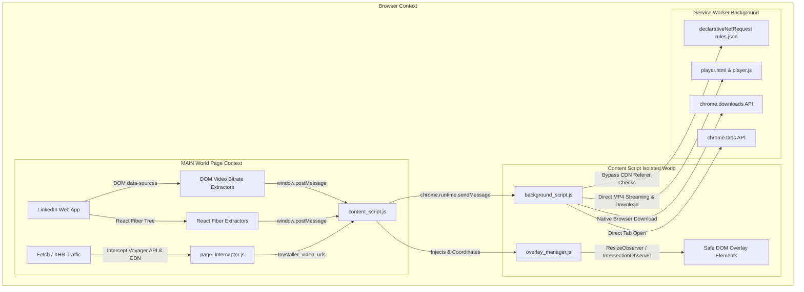

<div align="center">

# 🧸 Toystaller: LinkedIn Edition (v1.0)

**High-Performance, Stealth Media Downloader & In-Browser Player for LinkedIn**

[](https://developer.chrome.com/docs/extensions/mv3/intro/)
[](https://linkedin.com)
[](https://github.com/SudiptaSanki/Toystaller)
[](LICENSE)
[](DETAILS.md)

*A specialized, 100% client-side Chromium extension that extracts original high-resolution photos and progressive MP4 videos with complete audio from LinkedIn Feed, Profiles, Articles, Modals, and Messaging with an ad-free in-browser Anti-Redirect HTML5 player.*

---

### 🌐 Official Repositories & Documentation
* **LinkedIn Specialized Edition:** [https://github.com/SudiptaSanki/Toystaller-LinkedIn](https://github.com/SudiptaSanki/Toystaller-LinkedIn)
* **Facebook Specialized Edition:** [https://github.com/SudiptaSanki/Toystaller-Facebook](https://github.com/SudiptaSanki/Toystaller-Facebook)
* **Instagram Specialized Edition:** [https://github.com/SudiptaSanki/Toystaller-Instagram](https://github.com/SudiptaSanki/Toystaller-Instagram)
* **Main Global Multi-Platform Suite:** [https://github.com/SudiptaSanki/Toystaller](https://github.com/SudiptaSanki/Toystaller) *(Facebook, Instagram, LinkedIn, WhatsApp)*
* **Deep Technical Specification & Architecture:** [`DETAILS.md`](DETAILS.md)

</div>

---

## 🚀 Overview

**Toystaller: LinkedIn Edition (v1.0)** is an advanced browser extension engineered specifically for LinkedIn's single-page web client. Traditional downloaders rely on server-side scrapers that require you to paste links into ad-filled websites, or they scrape low-resolution preview URLs from the DOM.

Toystaller operates **100% client-side** inside your browser with **zero external backend server dependencies** (no local yt-dlp or ffmpeg server required). It directly accesses LinkedIn's internal React Fiber tree, DOM `data-sources` streaming arrays, and network buffers to extract the original, full-resolution progressive MP4 videos and maximum-quality photos directly from LinkedIn's official CDN (`*.licdn.com`).

---

## ⚡ Features & Section Support

| LinkedIn Section | Supported Media | Extraction Capability | UI & Behavior |
| :--- | :--- | :--- | :--- |
| **Feed (`/feed/`)** | Images, Native Videos, Shared Posts | Full-res photos via CDN URL upgrading (`/1000/`), highest-bitrate progressive MP4 | **Corner-Locking Engine**: Permanently locked corners; clean disappearance behind sticky header |
| **Profile (`/in/<username>/`)** | Profile Photos, Background Banners, Activity Media | High-res image extraction with automatic resolution upgrading | Buttons on all media; circular avatars filtered out |
| **Modals (`.artdeco-modal`, `[role="dialog"]`)** | Expanded Images, Video Players | Maximum quality media from modal context | **Zero-Bleed Isolation**: Background overlays suppressed when modal is open |
| **Articles & Newsletters (`/pulse/`)** | Embedded Images, Document Slides, Video Attachments | Original quality document images and video streams | Smart corner placement avoiding LinkedIn controls |
| **Messaging (`/messaging/`)** | Shared Photos & Videos | Original quality media attachments | Compact button scaling; ignores conversation avatars |

---

## 🎬 Anti-Redirect In-Browser HTML5 Player (The CDN 302 Bypass)

### The Problem
When you open a raw CDN video URL directly in a browser address bar tab, the browser sends top-level navigation headers:
```http
GET /video.mp4 HTTP/1.1
Sec-Fetch-Dest: document
Sec-Fetch-Mode: navigate
```
Platform CDNs reject top-level document requests to prevent unauthorized scraping and hotlinking, returning **HTTP 302 Redirects** back to the login page or **HTTP 403 Forbidden**.

### The Solution (100% Client-Side)
Toystaller solves this elegantly without external proxies:
1. Video URLs are routed through an internal dark-mode extension player tab:
   `chrome-extension://<id>/player.html?url=<encoded_video_url>`
2. Media loads inside an HTML5 `<video controls autoplay playsinline>` element, which sends genuine media headers (`Sec-Fetch-Dest: video; Sec-Fetch-Mode: no-cors`).
3. In combination with `rules.json` (`declarativeNetRequest`) injecting official `Referer: https://www.linkedin.com/` and `Origin: https://www.linkedin.com` headers, LinkedIn's CDN returns **HTTP 200 / 206 Partial Content** with complete video and audio.
4. Includes instant **"Download Video"** and **"Copy Link"** action buttons with real-time video resolution badges.

---

## 🛠️ Technology Stack & Architecture

Toystaller is built from the ground up with **Pure Modern Vanilla JavaScript** (ES2022+), zero third-party dependencies, and adheres strictly to **Google Chrome Manifest V3 specifications**.



### Core Technologies:
1. **Built-in HTML5 Video Player (`player.html` & `player.js`)**:
   - Streams master MP4 video files with audio directly inside a native browser tab.
   - Provides a one-click download button via `chrome.downloads` and a copy link button.
2. **Declarative Net Request Header Rewriting (`rules.json`)**:
   - Bypasses CDN anti-hotlinking by injecting official LinkedIn `Referer` and `Origin` headers into media network requests.
3. **Manifest V3 Service Worker (`background_script.js`)**:
   - Routes video URLs to the anti-redirect player page and manages asynchronous downloads.
   - Intercepts raw network response headers with `chrome.webRequest` for fallback URL tracking.
4. **Main-World DOM & React Fiber Hooking (`page_interceptor.js`)**:
   - Accesses DOM elements' hidden `__reactFiber$` and `__reactProps$` internal keys.
   - Extracts progressive MP4 streams with bitrate selection from `<video data-sources="...">`.
   - Harvests `streamingUrl` and `progressiveUrl` from Voyager API responses.
5. **LinkedIn CDN URL Upgrading (`platforms/linkedin.js`)**:
   - Automatically upgrades image resolution by replacing LinkedIn CDN size parameters (`/100/`, `/200/`, `/400/`, `/800/`) with `/1000/` for maximum quality.
6. **Overlay Stability & Corner-Locking Engine (`overlay_manager.js`)**:
   - **Corner-Locking Engine**: Once a corner (`top-left` or `top-right`) is picked, it is locked permanently for that element. Buttons never dynamically jump down across corners on scroll.
   - **Sticky Header Handling**: Hides cleanly when scrolling under LinkedIn's sticky navbar (`#global-nav`), restoring cleanly when scrolled back into view.
   - **Zero-Bleed Modal Isolation**: Real-time `MutationObserver` on `.artdeco-modal` ensures overlays only appear on the active dialog.
7. **Per-Section Toggle Settings (`popup.html` & `popup.js`)**:
   - Control panel allowing users to toggle overlays individually for Feed Posts, Pulse Articles, Profiles, and Messaging.

*(For exhaustive architectural diagrams and algorithms, read [`DETAILS.md`](DETAILS.md)).*

---

## 📦 Detailed Installation Guide (Step-by-Step)

To install and run **Toystaller: LinkedIn Edition** on any Chromium-based browser (Google Chrome, Brave, Microsoft Edge, Opera, Vivaldi, Arc):

### Prerequisites
- Any modern Chromium browser (Chrome 102+ recommended).
- Git installed on your machine (or download the source ZIP).

---

### Step 1: Clone or Download the Repository
Run the following command in your terminal:
```bash
git clone https://github.com/SudiptaSanki/Toystaller-LinkedIn.git
```
*Or click **Code ➔ Download ZIP** on GitHub and extract the folder to your preferred directory.*

---

### Step 2: Open Browser Extensions Page
1. Open your Chromium browser.
2. In the URL address bar, enter the corresponding URL:
   - **Google Chrome**: `chrome://extensions/`
   - **Brave Browser**: `brave://extensions/`
   - **Microsoft Edge**: `edge://extensions/`
   - **Opera**: `opera://extensions/`

---

### Step 3: Enable Developer Mode
Look in the top-right corner of the Extensions page and toggle the switch labeled **Developer mode** to **ON**.

```
[ Developer mode ]  <--- (Toggle this to ON)
```

---

### Step 4: Load Unpacked Extension
1. Click on the **Load unpacked** button in the top-left toolbar.
2. In the folder selection dialog, navigate to and select the repository root directory:
   ```
   Toystaller-LinkedIn/
   ```
3. Click **Select Folder** (or **Open**).

---

### Step 5: Pin and Verify the Extension
1. Click the **Puzzle icon** (Extensions menu) in your browser toolbar.
2. Locate **Toystaller: LinkedIn Edition** and click the **Pin icon** to pin it to your toolbar.
3. Open [LinkedIn](https://www.linkedin.com/) or refresh any existing LinkedIn tab.
4. Hover over any post image, video, or profile picture — you will see the **Blue (Open Media)** and **Red (Open Poster)** overlay buttons!

---

## 🎯 How to Use

1. **Play / Download Video via In-Browser Player**:
   - Hover over any video in the feed or a post.
   - Click the **Blue Button** with the arrow icon. The video will open directly in the internal **Toystaller Player tab** with full playback controls, audio, resolution badge, and an instant **Download Video** button.
2. **Open High-Res Photo in New Tab**:
   - Hover over any post image, document slide, or profile picture.
   - Click the **Blue Button** to open the maximum resolution photo (auto-upgraded to `/1000/` on LinkedIn CDN).
3. **Open Poster / Video Thumbnail**:
   - Hover over any video.
   - Click the **Red Button** to extract the full-size video cover artwork.
4. **Manage Section Settings**:
   - Click the Toystaller icon in your browser toolbar to toggle overlays for specific LinkedIn sections (Feed, Articles, Profiles, Messaging).

---

## 📂 Project Structure

```text
Toystaller-LinkedIn/
├── platforms/
│   └── linkedin.js            # Platform definitions & quality extractors
├── background_script.js       # Background Service Worker for downloads & webRequest
├── content_script.js          # Unified content script orchestrator & button injector
├── overlay_manager.js         # Smart DOM positioning, locked corners & modal isolation
├── page_interceptor.js        # Main-world Fetch/XHR interceptor & React Fiber reader
├── player.html                # Dark-mode Anti-Redirect HTML5 video player
├── player.js                  # Video player controller & direct download handler
├── popup.html                 # Overlay settings toggle menu
├── popup.js                   # Section toggle storage controller
├── rules.json                 # DeclarativeNetRequest header injection for CDN bypass
├── manifest.json              # Root Manifest V3 (loadable unpacked)
├── Toystaller_logo.png        # Extension icon / branding (optimized)
├── DETAILS.md                 # Exhaustive technical documentation & architecture guide
├── CONTRIBUTING.md            # Contributing guidelines & architecture reference
├── LICENSE                    # MIT License
└── README.md                  # Project documentation & installation manual
```

---

## 🛡️ Privacy & Security

- **100% Client-Side**: No user data, cookies, authentication tokens, or media URLs are ever transmitted to external servers.
- **Zero Third-Party Trackers**: No analytics, telemetry, or third-party dependencies.
- **Direct CDN Streams**: Media files are fetched directly from LinkedIn's official CDN servers (`*.licdn.com`).
- **Zero Risk of Account Bans**: Operates purely within standard browser media sessions.

---

## 🤝 Contributing & Support

Contributions, feature suggestions, and bug reports are warmly welcome!
- Check out the **Main Global Repository** for multi-platform support (Instagram, Facebook, LinkedIn, WhatsApp): [https://github.com/SudiptaSanki/Toystaller](https://github.com/SudiptaSanki/Toystaller)
- Read the **Technical Architecture Guide**: [`DETAILS.md`](DETAILS.md)
- Open an Issue or Pull Request on [GitHub Issues](https://github.com/SudiptaSanki/Toystaller-LinkedIn/issues).
