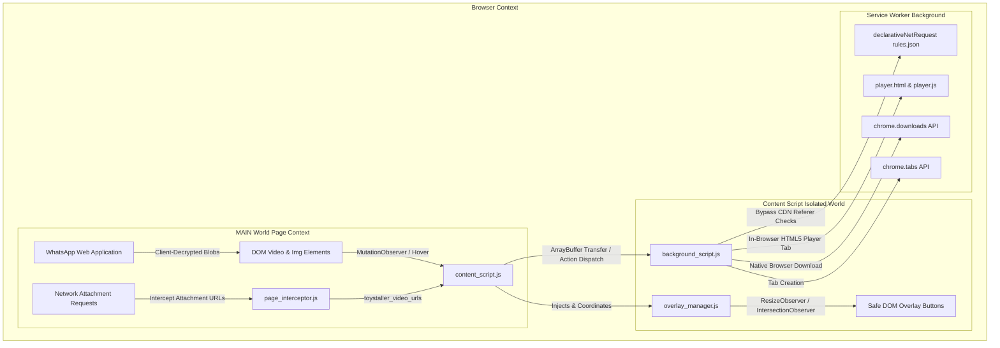

# 📘 Toystaller Technical Specification & Deep Architecture Guide

> **Main Global Multi-Platform Repository:** [https://github.com/SudiptaSanki/Toystaller](https://github.com/SudiptaSanki/Toystaller)  
> **WhatsApp Specialized Repository:** [https://github.com/SudiptaSanki/Toystaller-WhatsApp](https://github.com/SudiptaSanki/Toystaller-WhatsApp)  
> **Version:** 1.0 (Specialized Edition)  
> **Specification Target:** Chromium Manifest V3

---

## 📑 Table of Contents
1. [Executive Summary & Motivation](#1-executive-summary--motivation)
2. [Why Standard Media Downloaders Fail on WhatsApp Web](#2-why-standard-media-downloaders-fail-on-whatsapp-web)
3. [System Architecture Overview](#3-system-architecture-overview)
4. [Component Deep Dive](#4-component-deep-dive)
   - [4.1 Client-Side Decrypted Blob Extraction](#41-client-side-decrypted-blob-extraction)
   - [4.2 The Anti-Redirect In-Browser HTML5 Player (CDN 302 Bypass)](#42-the-anti-redirect-in-browser-html5-player-cdn-302-bypass)
   - [4.3 Overlay Manager & Permanently Locked Corner Engine](#43-overlay-manager--permanently-locked-corner-engine)
   - [4.4 Sticky Header Clearance & Scroll Disappearance](#44-sticky-header-clearance--scroll-disappearance)
   - [4.5 DeclarativeNetRequest & Referer Header Pipeline](#45-declarativenetrequest--referer-header-pipeline)
   - [4.6 Background Service Worker & Memory Buffer Transfer](#46-background-service-worker--memory-buffer-transfer)
5. [WhatsApp Section-by-Section Handler Matrix](#5-whatsapp-section-by-section-handler-matrix)
6. [Performance, Memory & Lifecycle Optimization](#6-performance-memory--lifecycle-optimization)
7. [Security, Sandboxing & Privacy Guarantees](#7-security-sandboxing--privacy-guarantees)
8. [Global Multi-Platform Ecosystem](#8-global-multi-platform-ecosystem)

---

## 1. Executive Summary & Motivation

**Toystaller: WhatsApp Edition** is engineered to provide seamless, one-click access to original-quality media on WhatsApp Web (`web.whatsapp.com`). WhatsApp Web decrypts media client-side in the browser, storing assets as transient `blob:` URLs within dynamic virtualized lists, status update viewers, message bubbles, and lightbox dialogs.

Traditional media scrapers fail because:
1. Media files are encrypted in transit and only decrypted locally within the authenticated user session.
2. Standard download tools attempting to navigate to `blob:` URLs directly are blocked by Chromium's top-frame blob navigation policy and WhatsApp's strict `Cross-Origin-Opener-Policy: same-origin` (COOP).
3. Raw CDN links to `*.whatsapp.net` reject external GET requests with HTTP 302 Redirects back to WhatsApp Web.

**Toystaller operates 100% client-side** inside the browser, intercepting decrypted buffers in-page and routing playback through a dedicated in-browser HTML5 player tab (`player.html`).

---

## 2. Why Standard Media Downloaders Fail on WhatsApp Web

```text
[WhatsApp Web Client]
   ├── 1. Client-Side Decryption: Media streams arrive as encrypted ciphertext chunks.
   │      WhatsApp Web decrypts them in-memory and creates transient blob URLs.
   ├── 2. Top-Frame Blob Navigation Restriction: Chromium blocks top-level document
   │      navigation to blob: URLs (Not allowed to navigate top frame to blob URL).
   ├── 3. Strict COOP / CSP: Cross-Origin-Opener-Policy: same-origin prevents window.open
   │      and iframe scripting from external or isolated frames.
   ├── 4. Virtualized Scroll Containers: Chat messages are virtualized, continuously
   │      creating, recycling, and destroying DOM media nodes on scroll.
   └── 5. CDN Referer Validation: Direct requests to *.whatsapp.net or *.fbcdn.net
          without genuine Referer headers trigger HTTP 302 redirects.
```

---

## 3. System Architecture Overview



---

## 4. Component Deep Dive

### 4.1 Client-Side Decrypted Blob Extraction
In `core/content_core.js`, Toystaller hooks directly into decrypted media elements:
- Images: Extracts the highest-resolution candidate from `srcset` or `currentSrc`.
- Videos: Resolves `media.currentSrc`, `media.src`, or `<source src>`.
- When "Open in Player" is triggered, `fetch(blobUrl)` extracts the raw decrypted bytes into an `ArrayBuffer` within the page's execution context.

### 4.2 The Anti-Redirect In-Browser HTML5 Player (CDN 302 Bypass)
When direct CDN video links (`*.whatsapp.net`, `*.fbcdn.net`) are opened as top-level navigation, CDNs return HTTP 302 Redirects.
Toystaller solves this 100% client-side:
1. Media is opened via `player.html?url=${encodeURIComponent(url)}` or `player.html?id=${mediaId}`.
2. Inside `player.html`, the media is consumed by a native `<video id="videoPlayer" controls autoplay playsinline>` element.
3. Requests sent by HTML `<video>` elements carry `Sec-Fetch-Dest: video` and `Sec-Fetch-Mode: no-cors`.
4. In combination with `rules.json` (`declarativeNetRequest`) injecting `Referer: https://web.whatsapp.com/` and `Origin: https://web.whatsapp.com`, CDNs recognize genuine embedded playback and return **HTTP 200 / 206 Partial Content** master streams.

### 4.3 Overlay Manager & Permanently Locked Corner Engine
- **Corner Locking**: When an overlay is initialized, `pickBestCorner(media, rect, container)` analyzes surrounding controls and selects the optimal corner (`top-right`, `top-left`, or `bottom-right`).
- **Immutability on Scroll**: Once locked in `entry.corner`, the position is never dynamically changed or shifted across corners while the user scrolls.

### 4.4 Sticky Header Clearance & Scroll Disappearance
- When a chat media bubble scrolls underneath WhatsApp's sticky conversation header (`#main header`, `top < topNavHeight + 4`), the overlay is immediately hidden (`display: 'none'; visibility: 'hidden';`).
- In Status Viewer mode (`wa-status`), `top >= 90px` is enforced, guaranteeing buttons sit safely below WhatsApp's native Play/Pause and Mute controls.

### 4.5 DeclarativeNetRequest & Referer Header Pipeline
Configured in `rules.json`:
- Intercepts requests targeting `||whatsapp.net` and `||whatsapp.com`.
- Sets `Referer` to `https://web.whatsapp.com/` and `Origin` to `https://web.whatsapp.com` for `main_frame`, `sub_frame`, `media`, and `xmlhttprequest`.

### 4.6 Background Service Worker & Memory Buffer Transfer
In `background_script.js`:
- Transferred `ArrayBuffer` payloads from decrypted blobs are temporarily cached in an in-memory `Map` keyed by a unique token.
- `chrome.tabs.create()` opens `player.html?id=${id}`.
- `player.js` requests the buffer via `getPlayerMedia` and cleans up memory immediately. Automatic 60-second garbage collection prevents memory leaks.

---

## 5. WhatsApp Section-by-Section Handler Matrix

| Section Key | Detection Selector | Preferred Corner | Offsets | Smart Filtering |
| :--- | :--- | :--- | :--- | :--- |
| `wa-status` | `status-v3-main`, `status-viewer`, status progress bars | `top-right`, `bottom-right` | `topOffset: 92px`, `bottomOffset: 84px` | Strict modal isolation; clears top controls and bottom reply drawer |
| `wa-media-viewer` | `[data-animate-media-viewer]`, `media-viewer-modal` | `top-left`, `bottom-right` | `topOffset: 72px`, `bottomOffset: 60px` | Suppresses background chat buttons; clears top-right close/forward/star icons |
| `wa-chat` | `div[role="row"]`, `msg-container` | `top-right`, `bottom-right` | `padding: 8px` | Ignores emojis, sticker previews, reaction pills, and voice notes |
| `wa-profile` | `drawer-right`, `chat-info-drawer` | `top-right`, `bottom-right` | `padding: 12px` | Excludes small contact list avatars (< 60px) |

---

## 6. Performance, Memory & Lifecycle Optimization

1. **Passive Scroll Listeners**: Scroll events are observed with `{ passive: true, capture: true }` and throttled pointer tracking (30ms).
2. **Observer Cleanup**: Disconnected media elements immediately have their `ResizeObserver` and `IntersectionObserver` disconnected and overlays removed from the DOM.
3. **Blob URL Revocation**: `URL.revokeObjectURL()` is called upon download completion and player page unloads.

---

## 7. Security, Sandboxing & Privacy Guarantees

- **No Remote Code Execution**: Strict CSP compliant with Manifest V3. No `eval()`, inline scripts, or external CDNs.
- **Client-Side Exclusivity**: Decrypted media and credentials never leave the user's browser session.
- **Account Safety**: Operates through standard user interactions with zero unauthorized API calls or scraping behavior.

---

## 8. Global Multi-Platform Ecosystem

| Specialized Edition | Repository | Primary Target |
| :--- | :--- | :--- |
| **WhatsApp Edition** | [Toystaller-WhatsApp](https://github.com/SudiptaSanki/Toystaller-WhatsApp) | `web.whatsapp.com` |
| **Facebook Edition** | [Toystaller-Facebook](https://github.com/SudiptaSanki/Toystaller-Facebook) | `facebook.com` |
| **Instagram Edition** | [Toystaller-Instagram](https://github.com/SudiptaSanki/Toystaller-Instagram) | `instagram.com` |
| **Global Suite** | [Toystaller](https://github.com/SudiptaSanki/Toystaller) | Multi-Platform |
