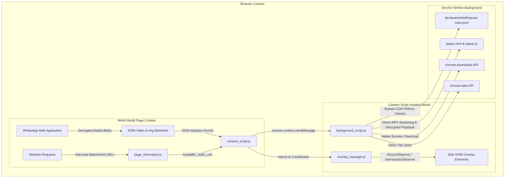

<div align="center">

# 🧸 Toystaller: WhatsApp Edition (v1.0)

**High-Performance, Stealth Media Downloader & Media Viewer for WhatsApp Web**

[](https://developer.chrome.com/docs/extensions/mv3/intro/)
[](https://web.whatsapp.com)
[](https://github.com/SudiptaSanki/Toystaller)
[](LICENSE)
[](DETAILS.md)

*A specialized, 100% client-side Chromium extension that extracts original decrypted high-resolution images, videos, and status updates directly from WhatsApp Web without third-party services, compression, or quality loss.*

---

### 🌐 Official Repositories & Documentation
* **WhatsApp Specialized Edition:** [https://github.com/SudiptaSanki/Toystaller-WhatsApp](https://github.com/SudiptaSanki/Toystaller-WhatsApp)
* **Facebook Specialized Edition:** [https://github.com/SudiptaSanki/Toystaller-Facebook](https://github.com/SudiptaSanki/Toystaller-Facebook)
* **Instagram Specialized Edition:** [https://github.com/SudiptaSanki/Toystaller-Instagram](https://github.com/SudiptaSanki/Toystaller-Instagram)
* **Main Global Multi-Platform Suite:** [https://github.com/SudiptaSanki/Toystaller](https://github.com/SudiptaSanki/Toystaller) *(WhatsApp, Facebook, Instagram, LinkedIn)*
* **Deep Technical Specification & Architecture:** [`DETAILS.md`](DETAILS.md)

</div>

---

## 🚀 Overview

**Toystaller: WhatsApp Edition** is a dedicated browser extension engineered specifically for WhatsApp Web (`web.whatsapp.com`). WhatsApp Web uses client-side decryption where media attachments are rendered as in-memory `blob:` streams inside dynamic virtualized scroll views, message bubbles, status/story viewers, and media lightbox overlays.

Traditional downloaders cannot capture WhatsApp media because the files are decrypted locally within the browser session. Toystaller operates **100% client-side** inside your browser with **zero external backend server dependencies** (no local yt-dlp or ffmpeg server required). It directly hooks into WhatsApp Web's media buffers and network streams to download original decrypted MP4 videos and full-resolution images, or stream them inside a dedicated in-browser HTML5 player.

---

## ⚡ Features & Section Support

| WhatsApp Section | Supported Media | Extraction Capability | UI & Behavior |
| :--- | :--- | :--- | :--- |
| **Status Updates (`wa-status`)** | Fullscreen Status / Story Updates | Full status video or photo in original quality | **Safe Placement & Header Clearance**: Positioned at `y >= 90px` completely clear of native Play/Pause and Mute controls; avoids story skipping |
| **Chat Media (`wa-chat`)** | Conversation Message Stream (Photos & Videos) | Client-decrypted original master MP4, unscaled full-res JPEG | **Zero-Leak & Corner-Locked**: Permanently locked corners that never jump on scroll; auto-hides when scrolling behind chat header |
| **Media Lightbox (`wa-media-viewer`)** | Fullscreen Dialog Photos & Videos (`[role="dialog"]`) | Maximum available resolution photo, full-length video stream | **Zero-Bleed Modal Isolation**: Instantly suppresses background message overlays; clears top-right close/forward/star buttons |
| **Contact & Info (`wa-profile`)** | Contact & Group Drawer Media Grid, Avatars | Uncompressed profile photo, media tile downloads | Clean overlay buttons on contact info and media gallery tiles |

---

## 🎬 Anti-Redirect In-Browser HTML5 Player (The CDN 302 Bypass Trick)

### The Problem
When raw media CDN links are opened directly in a new browser tab (`chrome.tabs.create({ url: cdnUrl })`), the browser initiates a top-level document navigation:
```http
GET /video.mp4 HTTP/1.1
Sec-Fetch-Dest: document
Sec-Fetch-Mode: navigate
```
Platform CDNs (`*.whatsapp.net`, `*.fbcdn.net`) reject top-level document requests to prevent unauthorized hotlinking, returning **HTTP 302 Redirects** back to the login page or failing navigation.

### The Solution (100% Client-Side)
Instead of opening raw links directly, Toystaller routes video playback through a built-in dark-themed player page:
`chrome.runtime.getURL('player.html') + '?url=' + encodeURIComponent(videoUrl)`

1. **How the Bypass Works**:
   - `player.html` loads the media inside a native HTML `<video id="videoPlayer" controls autoplay playsinline>` element.
   - Because the request originates from an HTML `<video>` element, Chromium sends:
     ```http
     Sec-Fetch-Dest: video
     Sec-Fetch-Mode: no-cors
     ```
   - In combination with `rules.json` (`declarativeNetRequest`) injecting the official `Referer: https://web.whatsapp.com/` and `Origin: https://web.whatsapp.com` headers, the platform's CDN considers this a genuine embedded playback request and returns **HTTP 200 / 206 Partial Content**.
   - **For client-decrypted `blob:` streams**: The content script reads the in-memory decrypted buffer, transfers it to the background service worker, and loads it into `player.html` via in-origin `URL.createObjectURL(blob)`, completely bypassing Chromium's top-frame blob navigation block and WhatsApp's COOP headers.
2. **Player Features**:
   - Modern, responsive dark-mode video player (`#0b141a` WhatsApp theme).
   - Top action bar featuring:
     - **"Download Video"** button calling `chrome.downloads.download({ url: videoUrl, filename: ..., saveAs: true })`.
     - **"Copy Link"** button for easy sharing.
     - Video resolution & format badge (e.g., `1080 x 1920 • HD MP4`).
   - Keyboard shortcuts: <kbd>Space</kbd> Play/Pause, <kbd>M</kbd> Mute, <kbd>F</kbd> Fullscreen, <kbd>D</kbd> Download, <kbd>←</kbd> / <kbd>→</kbd> Seek 5s.

---

## 🔒 Overlay Stability & Corner-Locking Engine

1. **Permanently Locked Corners**:
   - Once a corner (e.g., `top-right`) is selected for a media element via `pickBestCorner`, it is **permanently locked**.
   - As you scroll through long chat histories, buttons **never jump down to `bottom-right` or switch corners**.
2. **Clean Disappearance on Scroll Behind Headers**:
   - When a media element scrolls under the sticky chat conversation header (`#main header`, `top < topNavHeight + 4`), the overlay **cleanly hides** (`display: 'none'; visibility: 'hidden';`).
   - Buttons never slide along the navbar or float on top of header controls.
   - When scrolled back into view, the overlay reappears in its exact locked spot.
3. **Smart Filtering**:
   - Automatically excludes circular avatars in the left chat list (`#pane-side`), message reaction icons, emoji pickers, voice note waveforms, and small sticker previews.

---

## 🛠️ Technology Stack & Architecture

Toystaller is built with **Pure Modern Vanilla JavaScript** (ES2022+), zero third-party dependencies, and adheres strictly to **Google Chrome Manifest V3 specifications**.



---

## 📦 Installation Guide (Chromium Browsers)

Supported on **Google Chrome**, **Brave**, **Microsoft Edge**, **Opera**, **Vivaldi**, and all Chromium-based browsers.

### Step 1: Download or Clone the Repository
```bash
git clone https://github.com/SudiptaSanki/Toystaller-WhatsApp.git
```
*(Or download the ZIP archive from GitHub and extract it to a folder on your computer).*

### Step 2: Open Extensions in Your Browser
- **Chrome / Brave:** Navigate to `chrome://extensions/`
- **Microsoft Edge:** Navigate to `edge://extensions/`
- **Opera:** Navigate to `opera://extensions/`

### Step 3: Enable Developer Mode
- In the top-right corner of the Extensions page, toggle the **Developer mode** switch to **ON**.

### Step 4: Load Unpacked Extension
1. Click the **Load unpacked** button in the top-left corner.
2. Select the repository root folder `Toystaller-WhatsApp/`
   *(Or select the self-contained `whatsapp/` package subdirectory; both contain valid extension configurations).*
3. Click **Select Folder**.

### Step 5: Pin and Verify
1. Click the **Puzzle icon** (Extensions menu) in your browser toolbar.
2. Locate **Toystaller: WhatsApp Edition** and click the **Pin icon** to pin it to your toolbar.
3. Open [WhatsApp Web](https://web.whatsapp.com/) or refresh your existing tab.
4. Hover over any chat photo/video, status story, or lightbox image — you will see the **Green (Download)** and **Blue (Open in Player)** overlay buttons!

---

## 🎯 How to Use

1. **Download / Play Video in Full HD**:
   - Hover over any chat video or status update.
   - Click the **Blue Button** to open the video in the built-in Toystaller player tab.
   - Click **Download Video** in the player header to save the `.mp4` file directly.
2. **Download High-Resolution Image**:
   - Hover over any photo in a chat conversation, status update, or media lightbox.
   - Click the **Green Button** for instant, one-click direct download with custom timestamped filenames (`WhatsApp_Image_...jpg`).
3. **Status Story Downloads**:
   - View any WhatsApp Status update. Action buttons appear non-intrusively in the top-right of the video/photo, safely below the status header.
   - Click to download or stream without interrupting story playback.
4. **Customize Section Overlays**:
   - Click the Toystaller icon in your browser toolbar to toggle overlays on/off for specific sections:
     - **Show on Chat Media**
     - **Show on Status Updates**
     - **Show on Media Lightbox**
     - **Show on Contact & Info**

---

## 📂 Project Structure

```text
Toystaller-WhatsApp/
├── manifest.json            # Extension manifest (MV3, permissions, content scripts)
├── background_script.js     # Background Service Worker for downloads & player routing
├── content_script.js        # Content script orchestrator & button injection
├── overlay_manager.js       # Smart DOM positioning, corner-locking & modal isolation
├── page_interceptor.js      # Main-world Fetch/XHR interceptor & media reader
├── player.html              # Dedicated ad-free HTML5 video player page
├── player.js                # Player controller (playback, direct download, copy link)
├── rules.json               # DeclarativeNetRequest header rules for *.whatsapp.net
├── popup.html               # Popup settings panel UI (v1.0 Specialized Edition)
├── popup.js                 # Popup settings logic & tab synchronization
├── Toystaller_logo.png      # Extension branding & icon assets
├── platforms/
│   └── whatsapp.js          # Dedicated WhatsApp section detector & quality extractors
├── core/                    # Shared modular core architecture
│   ├── background_core.js
│   ├── content_core.js
│   ├── interceptor_core.js
│   └── overlay_manager.js
├── whatsapp/                # Self-contained standalone WhatsApp Edition package
│   ├── manifest.json
│   ├── background.js
│   ├── content.js
│   ├── platform.js
│   ├── player.html
│   ├── player.js
│   ├── rules.json
│   ├── popup.html
│   ├── popup.js
│   ├── icon.png
│   └── core/
├── DETAILS.md               # Exhaustive technical documentation & architecture guide
├── CONTRIBUTING.md          # Technical contributor guide
├── LICENSE                  # MIT License
└── README.md                # Project documentation & installation manual
```

---

## 🛡️ Privacy & Security

- **100% Client-Side**: No user messages, chats, contacts, cookies, or media tokens are ever transmitted to external servers.
- **Zero Third-Party Trackers**: No analytics, telemetry, or external dependencies.
- **No Risk of Account Bans**: Operates purely within your standard browser session without unauthorized scraping or suspicious API calls.
- **Direct Decrypted Streams**: Media files are extracted directly from your browser's local decrypted WhatsApp session.

---

## 🤝 Contributing & License

Contributions are welcome! Please read [`CONTRIBUTING.md`](CONTRIBUTING.md) and [`DETAILS.md`](DETAILS.md) for details on code style, architecture, and pull request workflows.

Distributed under the **MIT License**. See [`LICENSE`](LICENSE) for more information.
